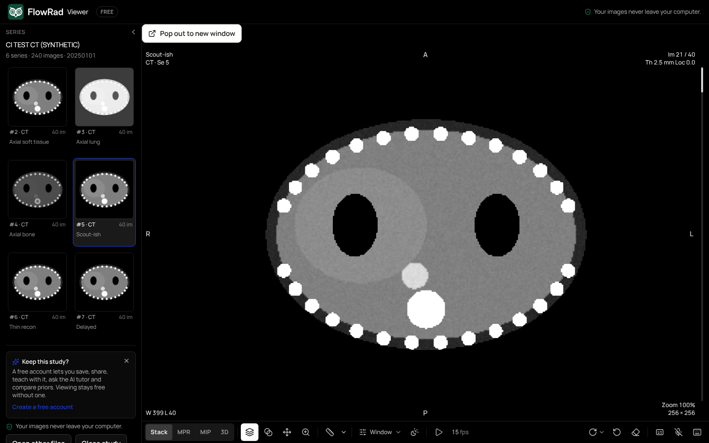
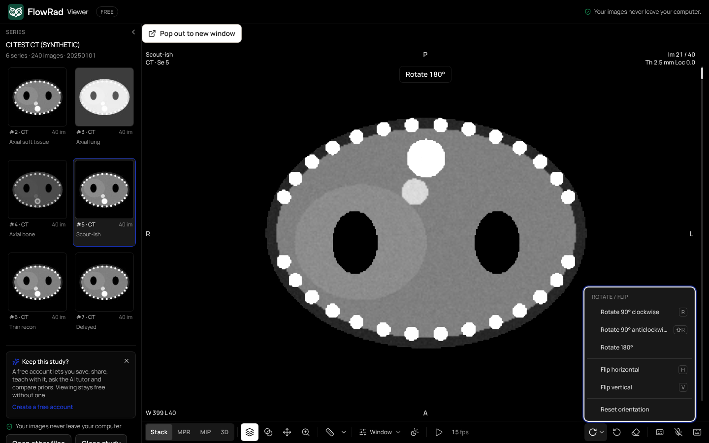
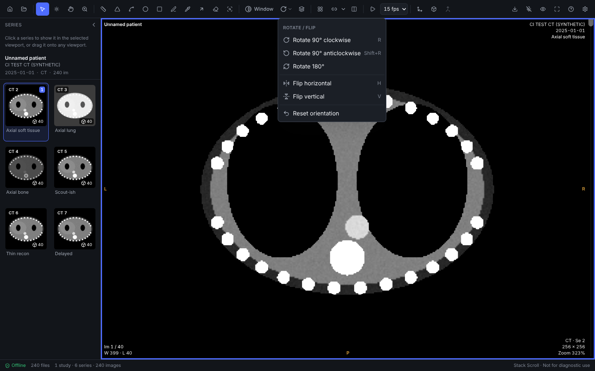
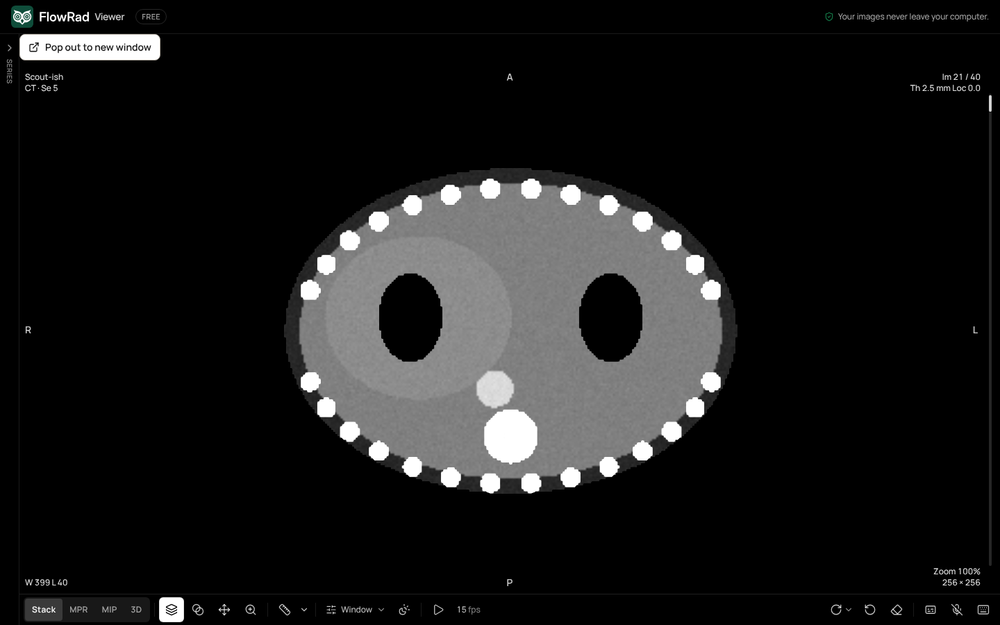
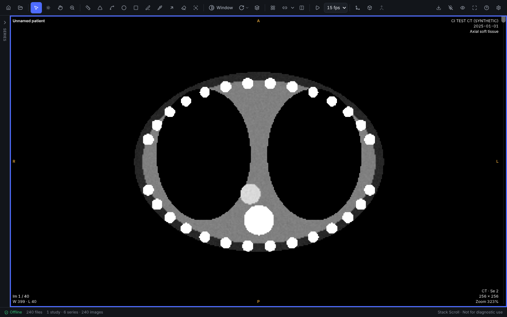

# FlowRad Viewer — feature checklist

What ships, where, and what proves it. Web = the free viewer (`/viewer`, `/viewer/local`) and
every `CornerstoneViewer`; Desktop = FlowRad Viewer (Tauri), both the native renderer
(`FLOWRAD_NATIVE`, default on Windows / macOS) and the JS path.

## Series thumbnails (web free viewer)

- [x] Each series card shows its **middle image**, rendered with the series' **own default
  window** (the file's Window Center / Width, else the image's range), box-filtered and stored
  as a ~128 px JPEG.
- [x] Under the image: **series number · modality · image count**, then the description
  (same card as the desktop series browser, two per row).
- [x] Generated **off the main thread**: the engine's decode workers decode the slice, a
  dedicated thumbnail worker windows, filters and encodes it (`OffscreenCanvas`).
- [x] **Lazy**: only rows on screen (plus a 120 px margin) are requested; a row scrolled away
  before its turn is dropped from the queue.
- [x] **After the first image**: nothing starts until the viewer reports the first image is up,
  then one thumbnail at a time in idle slots.
- [x] **Cached and counted**: a byte-capped LRU of object URLs (1 MB); that budget is taken out
  of the study's decoded-image cap (`localMemoryBudget.ts`). The raw DICOM file the loader parks
  for the decode is released again.
- [x] Skeleton while queued / decoding; a clear "no image" icon on failure.

Code: `packages/viewer-core/src/seriesThumbnail.ts` (pure, `lib/seriesThumbnail.test.ts`),
`localThumbnails.ts`, `seriesThumbnailWorker.ts`, `components/viewer/LocalSeriesThumb.tsx`.
e2e: `e2e/visual/series-panel.spec.ts` (real pixels with contrast, card text).

## Rotate / flip (web + desktop, native and JS paths)

- [x] Rotate 90° clockwise, 90° anticlockwise, 180°, flip horizontal, flip vertical, reset
  orientation — one command list (`viewOrientation.ts` `ORIENTATION_COMMANDS`) shared by:
  - the **toolbar** (one rotate button with a dropdown) on web and desktop,
  - the **right-click menu** ("Rotate / flip" submenu, shared `contextMenu.ts`),
  - the **keyboard**: R = 90° CW, Shift+R = 90° CCW, H = flip H, V = flip V, listed in the
    ? sheet. (Desktop: the rectangle ROI moved from R to S; Q / Shift+Q still rotate. Web: R
    rotates in the standalone viewers; in a student session R stays the exam "reveal" key.)
- [x] **Per viewport**, display only. **Screen-space flips** at any rotation (proved against the
  native renderer's own transform in `lib/viewOrientation.test.ts`).
- [x] **Orientation letters** (L/R/A/P/H/F) follow the image: native viewports compute them
  from the view (`orientMarkers`), the JS paths from the camera.
- [x] **Measurements and annotations rotate with the image** (native: image-space annotations
  mapped through the view transform; JS: world-space annotations).
- [x] Reset view also resets orientation.
- [ ] Free rotate by drag (optional; not in this release).

e2e: web `e2e/visual/series-panel.spec.ts`; desktop `desktop/scripts/e2e-ui.mjs --only orient`.

## Collapsible series panel (web + desktop)

- [x] A **chevron** in the panel header collapses it to a **slim rail** with an expand handle.
- [x] **Ctrl+B** (⌘B on a Mac) toggles it; listed in the ? sheet on both.
- [x] **Right-click → Hide / Show series panel**.
- [x] **Remembered per device** (`flowrad.seriesPanel.collapsed`, same key on both).
- [x] Viewports re-layout to use the space with **no re-decode** (the decoded cache is unchanged
  through collapse / expand — asserted in e2e) and no remount: the panel's content stays mounted
  while collapsed, so thumbnails are not rebuilt.

Code: `components/ui/CollapsiblePanel.tsx`, `components/viewer/useSeriesPanel.ts`,
`packages/viewer-core/src/seriesPanel.ts`.

